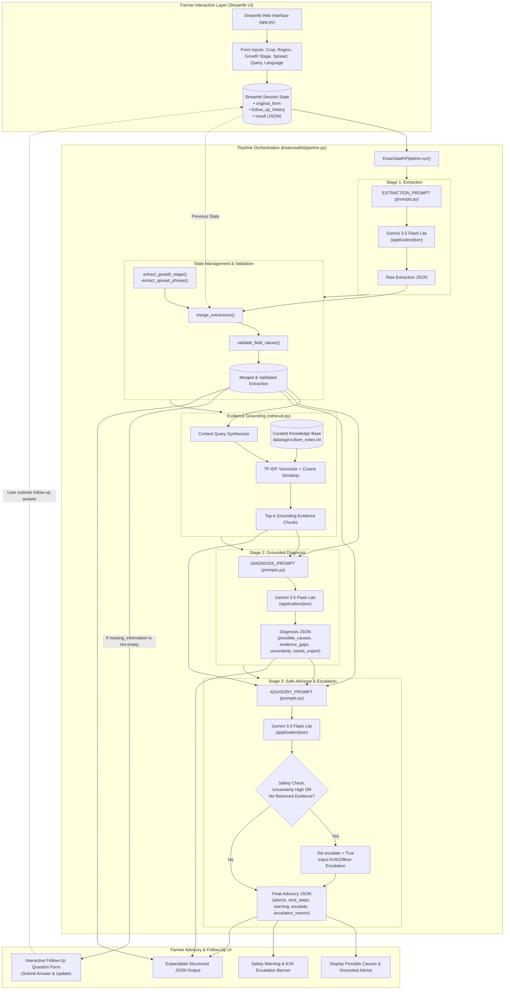
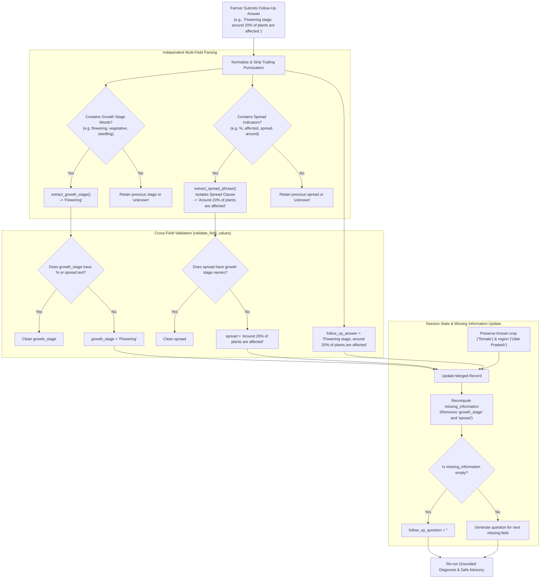

# KisanSaathi Architecture & Workflow Flowcharts

This document provides visual architectural diagrams representing the KisanSaathi end-to-end system architecture, the three-stage prompt workflow, multi-turn state preservation, and the safety escalation mechanism.

---

## 1. End-to-End System Architecture



---

## 2. Multi-Turn Follow-Up & Compound Answer Resolution



---

## 3. Sequence Diagram: Three-Stage Processing with Safety Guardrails

```mermaid
sequenceDiagram
    autonumber
    actor Farmer as Farmer / User
    participant UI as Streamlit UI (app.py)
    participant Pipe as Pipeline Orchestrator
    participant Gemini as Google Gemini 3.5 Flash Lite
    participant KB as TF-IDF Knowledge Base

    Farmer->>UI: Enter crop query & metadata (Hindi/Hinglish/English)
    UI->>Pipe: run(query, crop, region, stage, spread, language)

    Note over Pipe,Gemini: Stage 1: Extraction & Follow-Up Analysis
    Pipe->>Gemini: EXTRACTION_PROMPT (Query + Known Metadata)
    Gemini-->>Pipe: Extraction JSON (crop, symptoms, missing_info, follow_up_q)
    Pipe->>Pipe: merge_extractions() & validate_field_values()

    Note over Pipe,KB: Evidence Grounding
    Pipe->>KB: retrieve_notes(context_query, top_k=3)
    KB-->>Pipe: Grounded Reference Notes (Cautions, Irrigation, Escalation)

    Note over Pipe,Gemini: Stage 2: Grounded Diagnosis
    Pipe->>Gemini: DIAGNOSIS_PROMPT (Extraction + Reference Notes)
    Gemini-->>Pipe: Diagnosis JSON (possible_causes, evidence_gaps, uncertainty, needs_expert)

    Note over Pipe,Gemini: Stage 3: Safe Advisory Generation
    Pipe->>Gemini: ADVISORY_PROMPT (Extraction + Diagnosis + Notes + Language)
    Gemini-->>Pipe: Advisory JSON (advice, next_steps, warning, escalate)

    alt Uncertainty High OR Pest Dosage Requested OR Rapid Spread
        Pipe->>Pipe: Deterministic Safety Backstop (escalate = True)
    end

    Pipe-->>UI: Full Result Package (Extraction, Diagnosis, Advisory, Follow-up)
    UI-->>Farmer: Render Assessment, Advisory, Safety Banner, & Follow-Up Input
